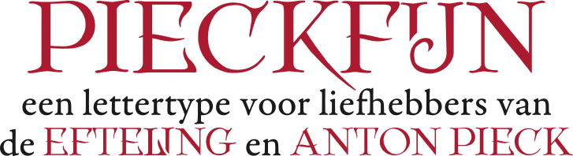

# Efteling-lettertypes

Dit repository bevat twee lettertypes:

- **Pieckfijn**: Een uitbreiding en opschoning van het reeds bestaande lettertype dat op het internet rondzwerft.
- **Clubsymbolen**: Een nieuw lettertype op basis van de [Efteling Clubgeheimtaal](https://www.eftepedia.nl/lemma/Efteling_Clubgeheimtaal) of het Symbolicaans schrift.

Momenteel werk ik aan een derde lettertype, Eersteling, dat Piecks schoonschrift-logo nabootst.

# Efteling Fonts

This repository contains two fonts:

- **Pieckfijn**: An expansion and refinement of an existing font that has been circulating online.
- **Clubsymbolen**: A new font based on the [Efteling Club Secret Language](https://www.eftepedia.nl/lemma/Efteling_Clubgeheimtaal) or the "Symbolican" script.
