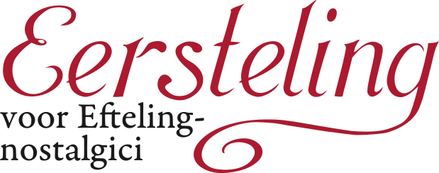

# Efteling-lettertypes

Dit repository bevat drie lettertypes:

- **Pieckfijn**: Een uitbreiding en opschoning van het reeds bestaande "Anton Pieck"-lettertype dat op het internet rondzwerft.
- **Eersteling**: Een nieuw lettertype op basis van het originele Efteling-logo in schoonschrift of krulschrift
- **Clubsymbolen**: Een nieuw lettertype op basis van de [Efteling Clubgeheimtaal](https://www.eftepedia.nl/lemma/Efteling_Clubgeheimtaal) of het Symbolicaans schrift.

# Efteling Fonts

This repository contains three fonts:

- **Pieckfijn**: An expansion and refinement of an existing font that has been circulating online.
- **Eersteling**: A new font based on the old Efteling logo
- **Clubsymbolen**: A new font based on the [Efteling Club Secret Language](https://www.eftepedia.nl/lemma/Efteling_Clubgeheimtaal) or the "Symbolican" script.
